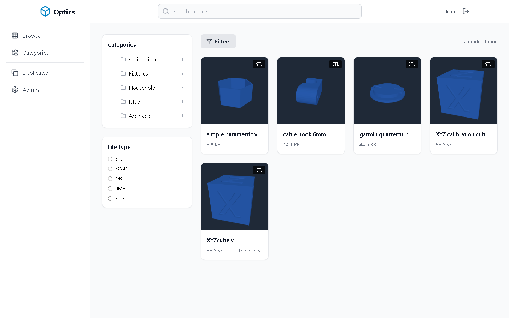
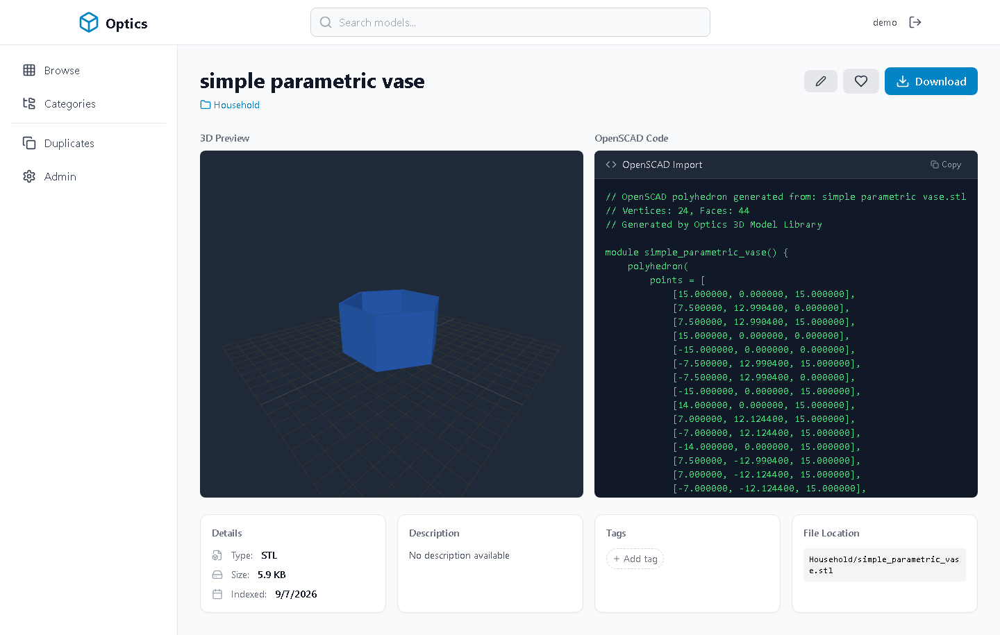
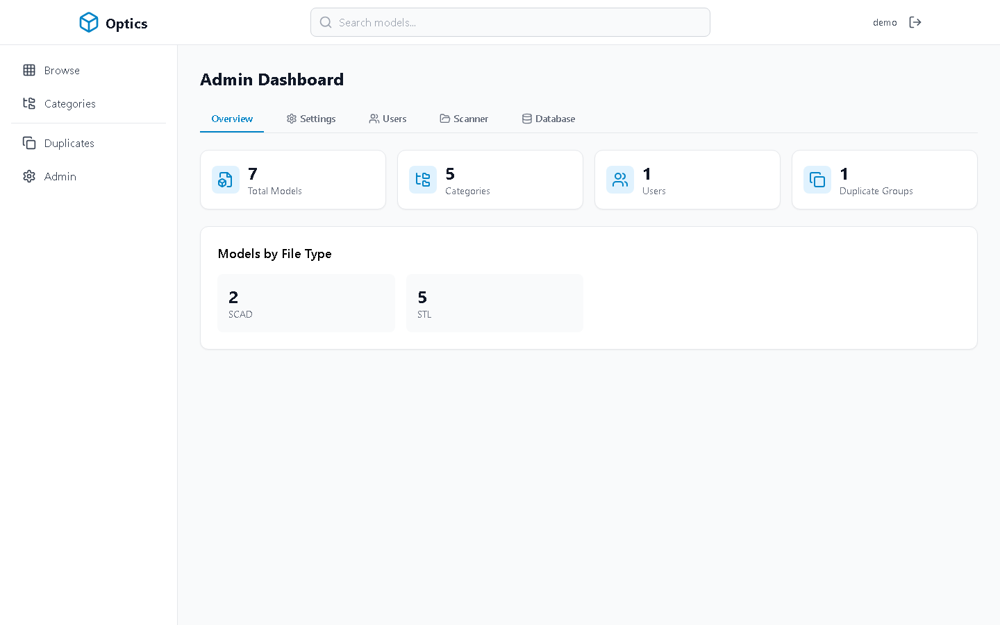

# Optics

A self-hosted web library for large collections of 3D model files. Point it at a
directory of STL/SCAD/OBJ files (loose or inside ZIPs), and it indexes, categorises
and previews them in the browser.

[](LICENSE)




## Quick start

Nothing to configure — the repo ships with a small CC0 sample library so a fresh
clone has something to look at.

```bash
git clone https://github.com/sp00nznet/Optics.git
cd Optics
cp .env.example .env          # edit DB_PASSWORD and JWT_SECRET
docker compose up -d
```

Then open <http://localhost:3333>, register an account (the **first** account
becomes admin), and hit **Admin → Scanner → Start Scan**. You should end up with
7 models across 5 categories, one of them indexed from inside a ZIP.

To use your own library instead of the samples, point `MODELS_PATH` at it and add
the overlay:

```bash
MODELS_PATH=/srv/3d-models docker compose \
  -f docker-compose.yml -f docker-compose.prod.yml up -d
```

## What it does

**Browsing and preview.** STL files render as real 3D previews — thumbnails in the
grid and a full orbit/zoom viewer on the detail page, all client-side via Three.js
on one shared WebGL context (browsers cap how many you can have).

**OpenSCAD panel.** SCAD files show their source. STL files get a generated
`polyhedron()` you can paste straight into OpenSCAD; OBJ and 3MF get an `import()`
statement.



**Scanning.** Walks the mounted directory, indexes anything with a known extension,
and looks *inside* ZIP archives — a file in an archive is indexed at
`archive.zip!path/inside/file.stl` and served straight out of the ZIP, no
extraction. Top-level folder names become categories. Thing IDs are pulled from
filenames and bundled `README.txt` files. Re-running a scan is safe; already-indexed
files are skipped.

**Duplicates.** Groups models by SHA-256 of their contents, so the same mesh loose
on disk and buried in a ZIP is caught. Detection is idempotent — re-running it
won't pile up groups.



**Admin.** Scan control with live progress and per-extension skip reasons, model
path management with a directory browser, user management, and library stats.

## Supported files

| Extension | Preview | OpenSCAD panel |
|-----------|---------|----------------|
| `.stl` | 3D viewer + thumbnail | Generated `polyhedron()` |
| `.scad` | — | Source, as-is |
| `.obj`, `.3mf` | placeholder | `import()` statement |
| `.step`, `.stp` | placeholder | — |
| `.zip` | contents indexed individually | per contained file |

## Testing

One headless script drives the whole stack in a real browser: registers, scans,
visits every page, asserts each rendered, and writes `docs/screenshots/`. The
screenshots in this README are its output.

```bash
docker compose up -d
cd test && npm install && npx playwright install chromium
npm run smoke
```

It exits non-zero on a console error, a failed request, a 5xx, a page that
redirected somewhere unexpected, or a view that never finished rendering.

## Stack

Go 1.21 + Gin, PostgreSQL 16, React 18 + TypeScript + Vite, Three.js, Tailwind,
Zustand + TanStack Query, JWT auth with bcrypt. Migrations run automatically on
backend start.

## Layout

```
backend/            Go API (cmd/server, internal/{config,database,handlers,middleware,models,router,services})
frontend/           React SPA (src/{api,components,hooks,pages,services,store})
sample-models/      CC0 models for local runs - see ATTRIBUTION.md
test/smoke.mjs      Headless end-to-end run + screenshots
docs/               Installation, configuration, API, architecture, development
```

## Documentation

- [Installation](docs/INSTALLATION.md)
- [Configuration](docs/CONFIGURATION.md)
- [API reference](docs/API.md)
- [Architecture](docs/ARCHITECTURE.md)
- [Development](docs/DEVELOPMENT.md)

## Sample models

`sample-models/` holds six CC0 models mirrored from the Internet Archive's
Thingiverse collection. Authors and source links are in
[sample-models/ATTRIBUTION.md](sample-models/ATTRIBUTION.md).

## License

MIT — see [LICENSE](LICENSE).
