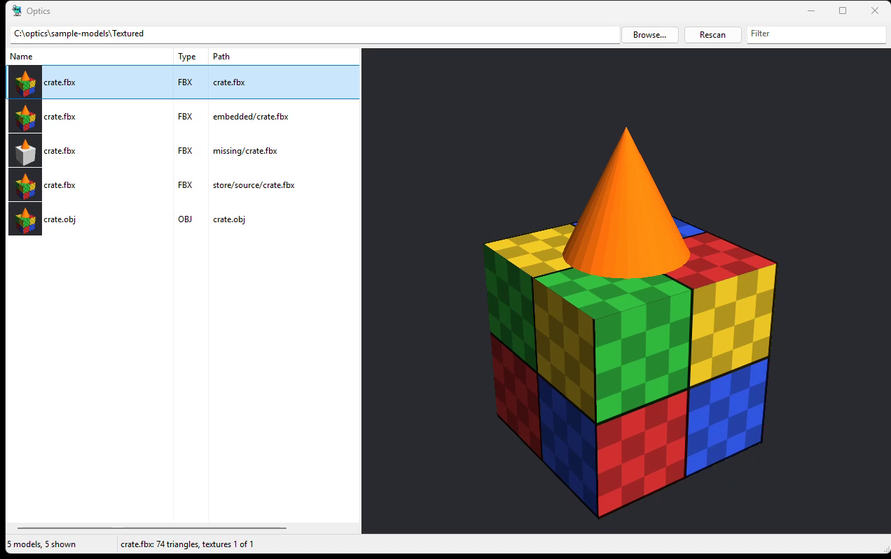
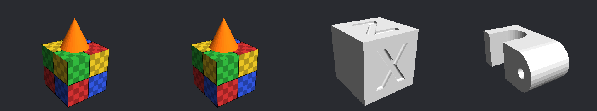

# Optics

A Windows desktop viewer for a folder of 3D models. Point it at a folder and it lists every
STL, OBJ, FBX, OpenSCAD, 3MF and STEP file in it, including the ones inside ZIP archives,
and shows the one you pick in a 3D view, with its textures.

## Status

**v0.1.0, alpha.** The viewer, the scanner and FBX/OBJ texture loading work and are tested
(conformance **11/11**, [docs/conformance.md](docs/conformance.md)). Before v0.1.0 it was a
self-hosted web app (Go, React, PostgreSQL, user accounts); that code is in git history
up to commit `6011261`. What is not done yet is in [ROADMAP.md](ROADMAP.md).

## Screenshots



Headless renders from `optics-check --render`, the same renderer with no window:



## Getting Started

### Quick start

1. Download this repository as a ZIP (green **Code** button, **Download ZIP**) and unzip it.
2. Double-click **`Setup.cmd`**. It checks for the Visual Studio C++ Build Tools and CMake,
   asks before installing anything (about 3 GB, through winget), builds Optics, and leaves
   an **Optics** shortcut in the folder. If something fails it says what to do in one line
   and keeps the details in `setup.log`. Rerunning it picks up where it stopped.
3. Double-click **Optics**, press **Browse...**, choose a folder of models.

### Step by step

Prerequisites: Windows 10 or 11 (x64), the
[Visual Studio 2022 Build Tools](https://visualstudio.microsoft.com/visual-cpp-build-tools/)
with **Desktop development with C++** (or Visual Studio 2022 with that workload), and
CMake 3.16+ (the workload's recommended components include it).

1. Get the source:
   ```
   git clone https://github.com/sp00nznet/Optics.git
   cd Optics
   ```
2. Configure:
   ```
   cmake -B build -A x64
   ```
   Ends with `-- Build files have been written to: .../Optics/build`.
3. Build:
   ```
   cmake --build build --config Release
   ```
   Ends with `Optics.vcxproj -> ...\build\bin\Optics.exe` and the same for `optics-check.exe`.
4. Check it:
   ```
   build\bin\optics-check.exe --selftest
   ```
   ```
   ok   inflate
   ok   kinds
   ok   ascii stl (z-up becomes y-up)
   ```
5. Run it on the bundled samples:
   ```
   build\bin\Optics.exe sample-models
   ```
   The list shows 13 files. Pick `crate.fbx` and you get a red, green, blue and yellow
   checkered box with an orange cone on top.

Usual trip-ups: `cmake` not found in a plain Command Prompt means it is only in the
"Developer Command Prompt" (open that, or install CMake from cmake.org and open a new
window so PATH updates). `-A x64` fails with "could not find any instance of Visual
Studio" when the C++ workload is missing; the Build Tools on their own without it don't count.

## Usage

- **Pick a folder**: Browse..., type a path and press Enter, drop a folder (or a file) on
  the window, or pass it on the command line: `Optics.exe D:\models`. The last folder is
  remembered (`HKCU\Software\Optics`). `Optics.exe D:\models\ship.fbx` opens the folder
  with that file selected.
- **Filter**: type in the box at the top right; it matches anywhere in the path, so `fbx`,
  `textures` or `.zip!` all work.
- **The list**: every model gets a rendered thumbnail, drawn in the background as rows
  come into view, so a big folder lists straight away and fills in as you scroll.
- **The view**: drag to orbit, scroll to zoom, double-click to reset. `.scad` files show
  their source instead. Enter or double-click in the list opens the file in its default
  program (a zip member opens its zip).
- **The status bar** says how many triangles, and how many of the model's textures were
  found: `crate.fbx: 74 triangles, textures 1 of 1`. A missing one is named.

| Extension | Shown as |
|---|---|
| `.fbx` | 3D, with diffuse/base-colour textures, embedded or external ([how they're found](docs/textures.md)) |
| `.obj` | 3D, with `.mtl` materials and textures |
| `.stl` | 3D (binary and ASCII) |
| `.scad` | source text |
| `.3mf`, `.step`, `.stp` | listed, no preview yet |
| `.zip` | every model inside it is listed and opens straight from the archive |

### optics-check

The console half, for scripts and CI:

```
optics-check --render sample-models\Textured\crate.fbx crate.png 800x600
optics-check --render "sample-models\Archives\textured_crate.zip!crate/crate.fbx" crate.png
optics-check --check sample-models tests\expected.tsv
```

`--render` draws with Windows' software OpenGL into memory, so it works with no display
(CI, RDP, a service). `--check` is the conformance harness.

## Building from source

As in Step by step above. The build is CMake over plain C11 with MSVC at `/W4 /WX`, and
links the C runtime statically so the exe runs without a redistributable. How the parts
fit together: [docs/architecture.md](docs/architecture.md). To regenerate the textured
samples: `blender -b --factory-startup --python tools/make_samples.py`.

## License

MIT, see [LICENSE](LICENSE). Third-party code (ufbx, stb) is listed in [NOTICE](NOTICE)
with its licences under `LICENSES/`; sample models and the icon are in
[PROVENANCE.md](PROVENANCE.md).
